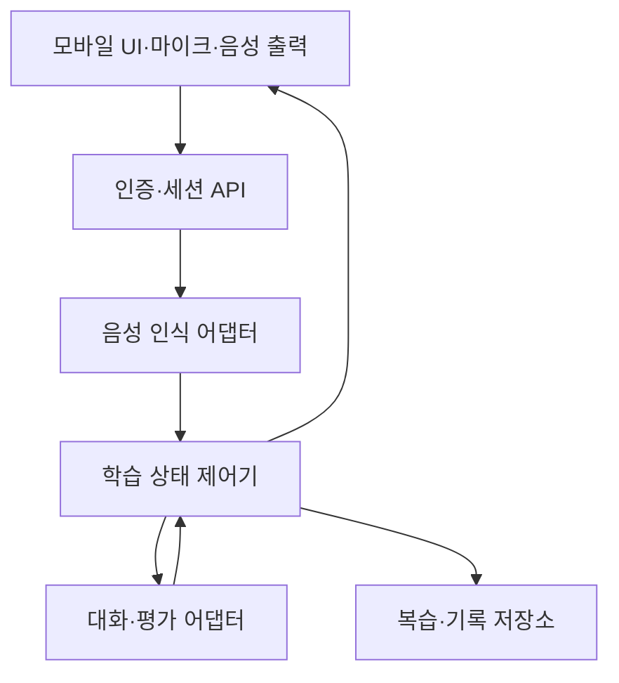

# 모바일 영어 회화 학습 서비스 — Codex 최종 개발 설계서

- 문서 버전: 1.0
- 작성일: 2026-10-21, Asia/Seoul
- 용도: Codex 구현 착수·범위 판단·검수 기준
- 상태: 사용자 요구사항 확정 / 기술 구성 및 실제 기기 성능은 구현 단계에서 검증
- 작업명: 이어말하기. 임시 명칭이며 브랜드·상표 검토 완료를 의미하지 않는다.

## 0. Codex가 먼저 읽을 요약

한국어 사용 성인이 모바일에서 일상 영어를 연습하는 개인용 서비스를 만든다. 사용자는 짧게 답할 수 있지만 문장을 조립하고 대화를 이어가는 것이 어렵고, 상대방의 질문을 받으면 긴장하며, 다양한 표현을 사용하고 싶어 한다.

핵심 경험은 다음과 같다.

> 상황 선택 → 짧은 영어 질문 듣기 → 자기 문장으로 답하기 → 답변 직후 핵심 교정 → 예문을 가리고 다시 말하기 → 후속 질문 → 다른 상황에서 재사용 → 다음 학습에서 간격 복습.

첫 버전은 개인 학습용 모바일 웹이다. 자연스럽게 번갈아 말하는 자동 음성 대화를 목표로 하고, 버튼 입력과 텍스트 입력은 복구 경로로 제공한다. 카메라·화면 공유·결제·네이티브 앱은 제외한다. 유료 API를 기본 의존성으로 만들지 않는다. Codex는 개발 도구이며 실행 중 AI 공급자로 확정된 것이 아니다.

무료 우선 기술 경로는 기존 PC에서 자체 실행하는 음성 인식·언어 모델과 휴대폰 브라우저의 음성 출력을 조합하는 것이다. 기존 PC 사용 가능 여부·사양은 미확인이다. 따라서 M0에서 실행 환경을 검사하고 실현 가능성을 먼저 보고한다. PC가 없거나 성능이 부족하면 휴대폰 단독 실행이나 무료 외부 서비스가 가능하다고 단정하지 않는다.

UI만 구현하거나 미리 정한 답을 재생하는 것으로 실제 AI 음성 학습이 완성됐다고 보고하지 않는다. 본 문서는 개발 설계서이며 코드 구현·실제 음성 성능·학습 효과의 검증 결과가 아니다.

## 1. 결정 사항과 우선순위

### 1.1 사용자가 확정한 요구사항

| ID | 확정 요구사항 | 구현 의미 |
|---|---|---|
| U01 | 개인 학습 우선, 추후 서비스 확장 | 소규모 자체 실행으로 시작하되 사용자 소유권과 공급자 경계를 분리 |
| U02 | 모바일 우선 | iPhone Safari를 1차 실제 기기 검증 대상으로 삼음 |
| U03 | 일상 회화 | 기술지원·업무 영어를 초기 기본 콘텐츠로 넣지 않음 |
| U04 | 가능한 무료 | 기존 기기를 활용해 회당 외부 유료 API 호출 없는 경로 우선 |
| U05 | 자연스러운 음성 대화 | 사용자가 매 턴 버튼을 누르지 않는 자동 발화 감지 목표 |
| U06 | 짧게 답하지만 대화를 이어가기 어려움 | 짧고 쉬운 질문, 답변 확장 지원, 초기 레벨 고정 진단 금지 |
| U07 | 문장 조립이 주된 어려움 | 문장 뼈대 → 의미 단서 → 도움 없는 답변으로 지원 축소 |
| U08 | 질문을 받으면 긴장함 | 발화 중 교정 금지, 강제 카운트다운 금지, 재시도·건너뛰기 허용 |
| U09 | 표현의 다양성이 가장 중요 | 같은 의도를 다른 표현·다른 상황에서 말하는 연습 |
| U10 | 매 답변 직후 교정 | 발화가 끝난 뒤 필요한 오류 하나를 우선 안내 |
| U11 | 단계별 힌트 | 기다리기 → 한국어 의미 힌트 → 영어 첫 구절 → 전체 예문 |
| U12 | 기억한 표현을 실제 상황에서 사용 | 따라 읽기와 독립적인 재사용을 별도 기록 |

위 사항을 다시 질문하지 않는다. UI 색상·폴더 구조·정확한 기본 시간처럼 되돌릴 수 있는 선택은 개발자가 결정하고 기록한다. 비용 발생·계정 연결·외부 공개·새 장비 구매·핵심 요구사항 축소가 필요하면 대안과 근거를 정리해 사용자에게 확인한다.

### 1.2 개발 기본값: 사용자 확정값과 구별

- 한국어 UI, 영어 음성 대화, 한국어 교정 설명.
- 1회 10분을 기본 안내로 사용하되 연장·조기 종료 가능. 최적 학습 시간이라는 의미가 아니다.
- 번역은 접힌 상태로 시작하고 눌러 확인. 표시·숨김 설정 제공.
- 질문은 보통 영어 1~2문장, 한 번에 하나. 초기 답변 기대치는 1~3문장.
- 외부 연결 없는 개인 설치에서 프로필은 하나. 모든 기록은 처음부터 user_id 소유권 보유.
- 사용자의 10분·번역 기본값 선택을 다시 요구하지 않는다. 설정에서 바꿀 수 있게 구현한다.
- ‘네이티브처럼’, ‘자동 암기’, ‘절대 잊지 않음’, 특정 기간 내 유창성 달성을 보장하는 문구를 쓰지 않는다.

### 1.3 우선순위

P0: 실제 모바일 음성 왕복, 문장 조립 지원, 즉시 핵심 교정, 독립 재시도, 표현 변형, 간격 복습, 저장·삭제, 무료 실행 경계, 오류 복구.

P1: 대화 이력·성장 추세·표현 카드 편집·내보내기/가져오기·홈 화면 추가.

P2: 외부 이용자 계정, 동기화, 카메라·화면 공유, 고품질 별도 음성 합성, 과금. 첫 버전 범위에 포함하지 않는다.

## 2. 학습 목표와 비목표

### 목표

1. 익숙한 상황에서 짧은 문장을 스스로 조립한다.
2. 답변에 이유·경험·선호를 하나 덧붙인다.
3. 같은 의도를 둘 이상의 적절한 표현으로 말해 본다.
4. 외운 질문과 다른 질문에도 표현을 바꿔 사용한다.
5. 단어가 떠오르지 않을 때 설명·되묻기·바꿔 말하기로 대화를 유지한다.
6. 시간이 지난 뒤 도움 없이 표현을 다시 사용한다.

### 비목표

- 모범 답안과 문장 전체가 일치해야 정답이라는 채점.
- 어려운 동의어를 많이 사용하거나 빨리 말할수록 높은 점수를 주는 구조.
- 번역·힌트를 사용했다고 실패로 비난하는 구조.
- AI 텍스트 평가를 발음·억양의 정밀 점수로 제시하는 기능.
- 임상적 불안 진단, 공인 영어 등급 판정, 모든 상황에 대한 네이티브 수준 보장.

## 3. 콘텐츠와 학습 동작

### 3.1 초기 시나리오 5개

| 시나리오 | 말하기 의도 | 첫 문장 뼈대 예시 | 변형 과제 |
|---|---|---|---|
| 카페 주문 | 주문·요청·변경 | I'd like …, please. | 음료 변경, 테이크아웃, 품절 대안 |
| 주말 이야기 | 과거 경험·이유 | I … last weekend. | 집/외출, 날씨, 예상 밖 후속 질문 |
| 취미 소개 | 선호·빈도·이유 | I like … because … | 취미 추천, 싫어하는 활동, 함께할 제안 |
| 식당 대화 | 요청·확인·정중한 정정 | Could I have …, please? | 물·메뉴·계산서, 주문 확인 |
| 일상 약속 | 제안·거절·대안 | How about …? | 시간 변경, 다른 장소, 정중한 거절 |

각 시나리오에 첫 질문 3개 이상, 의도 3개 이상, 뜻이 통하는 대안 2개 이상, 보지 않은 후속 질문 5개 이상, 단계별 힌트 예시와 전이 과제 2개 이상을 작성한다. 콘텐츠는 코드에서 분리하고 scenario_version을 기록한다.

예문은 새로 작성한다. 참고 영상의 캐릭터·상표·문구·화면을 그대로 복제하지 않는다. 문화적·상황적 말투 차이를 설명하며 지역별 구어체를 일괄 오답으로 처리하지 않는다.

### 3.2 문장 조립 지원

문법 용어보다 전달하려는 내용의 순서를 보여준다.

예: ‘평소 하는 일 → 오늘 달랐던 일 → 이유’.

- A 단계: `I usually …, but today I … because …` 뼈대와 예문.
- B 단계: ‘평소 / 오늘 / 이유’ 의미 단서만 표시.
- C 단계: 질문만 제공. 사용자가 원하면 언제든 힌트를 다시 열 수 있음.

지원 수준은 의도·표현별로 관리한다. 한 번 맞혔다고 모든 주제의 도움을 제거하지 않는다. 초기 기본 규칙은 서로 다른 질문에서 도움 없는 성공 2회 후 다음 단계 제안, 실패/힌트 사용 시 도움 복원으로 한다. 이는 조정 가능한 제품 규칙이며 연구로 확정한 최적 기준은 아니다.

### 3.3 표현 확장

한 답변에 대안은 최대 하나만 추가한다. 적절한 기존 표현은 그대로 인정하고 ‘오류 수정’과 ‘다른 표현’을 분리한다.

예: `I'd like a latte, please.` → `Could I have a latte, please?`.

표현을 선택한 뒤 물건·시간·장소·상대방·이유 중 하나를 바꿔 사용한다. 매번 새 표현을 강제하지 않고 같은 표현을 안정적으로 재사용하는 것도 인정한다. 단순 단어 치환만으로 전이 능력이 검증됐다고 표시하지 않는다.

### 3.4 대화 복구

단어가 막히면 한국어 단어 입력도 허용하되, 다음에는 영어 설명으로 표현해 보도록 돕는다. 예:

- `What do you call …?`
- `I mean …`
- `It's something you use to …`
- `Could you say that again?`

의미가 통하는 쉬운 설명도 성공으로 인정한다. 어려운 단어의 정답만 요구하지 않는다.

## 4. 세션 전체 흐름

1. 홈: 이어서 학습·오늘 복습·새 상황 중 하나를 선택.
2. 기기 검사: 첫 실행에만 마이크·영어 음성·서버 연결·실행 모드 확인. 대화 시작은 명시적 사용자 동작으로 실행.
3. 도입: 주제와 목표 표현을 짧게 안내. 복습 예정 항목이 있으면 1~2개부터 시작.
4. 본 대화: AI의 짧은 질문 → 사용자 답변 → 필요 시 핵심 교정 → 다시 말하기 → 다음 질문.
5. 표현 변형: 익숙한 표현으로 조건을 바꾼 질문에 답함.
6. 전이 확인: 영어 예문·뼈대를 먼저 보여주지 않는 새 상황에 답함.
7. 종료: ‘잘한 점 / 교정한 표현 / 다음에 쓸 표현’을 각각 짧게 제공. 카드 자동 후보는 최대 3개.
8. 다음 학습: 복습 예정 항목을 새 질문에서 사용. 사용자가 예정일에 접속하지 않아도 실패·연속기록 상실로 압박하지 않음.

긴 대화가 끝나기 전에 종료해도 저장된 턴까지 요약 가능해야 한다. 종료 요약이 실패해도 대화 기록은 남고 재생성 가능해야 한다.

## 5. 즉시 교정과 힌트의 정확한 정책

### 5.1 매 답변 직후 처리

- 발화 도중 끊어 고치지 않는다. 확정된 발화 뒤에만 평가한다.
- 의미 전달을 방해하거나 반복되는 핵심 오류가 있으면 하나만 안내한다.
- 문제가 없으면 적절한 답변임을 인정한다. 선택적 대안 표현은 오류처럼 표시하지 않는다.
- ‘다시 말하기’ 발화는 재시도 평가로 처리하고, 새 문법·새 표현을 계속 추가하는 무한 교정 루프를 만들지 않는다.
- 재시도는 기본 2회까지 제안하고, 이후 ‘도움 받고 계속’ 또는 ‘다음으로’를 제공한다. 건너뛰기는 불이익 없음.
- 전사 자체가 의심스럽거나 사용자가 ‘잘못 들었어요’를 선택하면 교정·복습 판정을 보류한다. 사용자가 전사를 수정하면 해당 버전으로 다시 평가한다.

### 5.2 다시 말하기와 다음 질문의 충돌 방지

교정이 필요한 턴에서는 ‘다시 말하기’ 한 가지 행동만 활성화한다. 다음 질문은 준비할 수 있지만 화면·음성으로 먼저 출력하지 않는다. 재시도 완료 또는 사용자의 계속 선택 후에만 다음 질문을 공개한다.

이미 적절한 답변이고 대안 표현을 선택하지 않았다면 불필요한 재시도를 강제하지 않는다. 사용자 선택 시에만 대안 표현 연습을 한다.

### 5.3 힌트 단계

| 레벨 | 제공 내용 | 학습 기록 |
|---|---|---|
| H0 | 질문만, 영어 답 없음 | independent 후보 |
| H1 | 한국어로 전달할 의미의 방향 | meaning_hint |
| H2 | 영어 첫 구절 또는 문장 뼈대 | english_stem |
| H3 | 전체 예문과 뜻 | full_example |

문장 뼈대·정답 전사·직전 개선문을 본 경우도 노출 사실을 기록한다. ‘힌트 버튼을 누르지 않았다’만으로 독립 성공으로 처리하지 않는다.

무응답 시 기본 8초 뒤 ‘조금 더 생각하기 / 힌트 보기’를 조용히 표시한다. 자동으로 정답을 읽어주거나 발화를 재촉하지 않는다. 사용자가 힌트를 요청하면 H1→H2→H3 순서로 제공한다. 8초는 변경 가능한 UI 기본값이며 기억력·긴장의 측정값이 아니다.

## 6. 기억·복습·성장 기록

### 6.1 성공 유형 분리

- model_imitation: 전체 예문을 본 직후 따라 말함.
- supported_production: 한국어 힌트·뼈대 등의 도움으로 말함.
- independent_production: 답을 노출하지 않은 질문에서 도움 없이 자기 문장을 구성함.
- novel_context_transfer: 훈련 문구를 먼저 보여주지 않는 다른 상황에서 의도를 전달함.
- unassessable: 전사 불확실·오류·중단 등으로 평가할 수 없음.

모델의 ‘잘했어요’ 문구와 성공 유형을 동일시하지 않는다. 서버가 실제 힌트 노출·전사 버전·질문 유형을 함께 검사해 최종 유형을 결정한다.

### 6.2 간격 복습 기본 알고리즘

첫 독립 성공 이후 다음 학습일, 3일 뒤, 7일 뒤, 14일 뒤를 초기 후보 간격으로 둔다. 이는 제품 기본값이며 에빙하우스 곡선에서 계산한 개인별 최적 일정이 아니다.

- 도움 없는 성공: 단계별 간격 증가.
- 힌트 사용 성공: stage 유지, 다음 학습일 재노출.
- 실패: 도움 제공 후 같은 세션 후반에 한 번 재사용하고, 다음 학습일 복습.
- 전사 불확실/중단: 단계·성공률 변경 없음.
- 하루에 같은 표현을 반복해도 긴 간격 단계는 한 번만 진전. 따라 읽기만으로 단계 상승 금지.
- 복습량 초과: 세션 초반 기본 3개 이내, 나머지는 이후 세션으로 분산. 연체 항목을 전부 강제하지 않음.
- UTC로 저장하고 프로필의 IANA 시간대에서 학습일을 판정. 초기 Asia/Seoul, 자정 경계와 재시도 중복을 검사.

### 6.3 표시할 성장 정보

| 정보 | 계산·해석 |
|---|---|
| 도움 없는 답변 | 평가 가능한 최초 답변 중 independent 비율, 분모 함께 표시 |
| 문장 확장 | 이유·세부 설명을 적절하게 덧붙인 사례와 원문 근거 |
| 표현 범위 | 의도별로 실제 사용한 표현군, 검수 가능한 사례 제공 |
| 상황 전이 | 처음 보는 상황에서 도움 없이 의도를 전달한 시도/성공 |
| 복습 유지 | 지연 복습에서의 독립 성공/힌트 성공/평가 보류 구분 |
| 대화 복구 | 설명·되묻기·다른 표현으로 이어간 사례 |

AI 추정 지표는 ‘학습 참고 기록’으로 표시한다. 짧은 세션의 어휘 종류 수를 전체 표현력 점수로 환산하지 않는다. 전사 오류·힌트·문제 난이도를 무시한 속도 순위 금지. 학습 효과 검증은 UI의 테스트 통과와 별도다.

## 7. 모바일 화면 구성

화면은 홈·대화·복습·기록·설정의 5개 주요 영역으로 제한한다. 첫 화면을 거대한 대시보드로 만들지 않는다.

### 대화 화면

- 상단: 현재 상황, 일시정지, 종료.
- 중앙: 현재 AI 질문과 내 마지막 답변. 전체 대화는 별도 펼침.
- 교정 영역: 핵심 교정 하나 / 선택적 다른 표현 하나를 구분.
- 하단: 듣는 중·생각하는 중·말하는 중 상태, 힌트, 다시 듣기, 음성 중지, 텍스트 입력.
- 다시 말하기 단계에서는 ‘지금 다시 말할 내용’이 명확해야 하며 다음 질문을 섞지 않는다.
- 한 화면의 주된 행동은 하나. 번역·예문·뼈대는 접고 펼칠 수 있음.
- 긴 한국어 설명과 긴 영문 답변이 화면 밖으로 잘리지 않게 함.
- 세로 화면·안전 영역·가상 키보드·텍스트 확대를 고려하고 가로 스크롤 없음.
- 색상에만 의존하지 않는 상태 표시, 버튼 이름, 초점 순서, 음성 외 텍스트 대체 수단 제공.
- 영어 음성 1개를 기본 선택하되 기기에 없는 음성 이름을 하드코딩하지 않음.

서비스명·미세 디자인 선택은 구현자가 결정 가능하다. 화면 구현을 위해 추가 사용자 설문을 반복하지 않는다.

## 8. 비용·실행 환경·지원 범위

### 8.1 ‘무료 우선’의 정의

필수 경로에 외부 유료 API·유료 음성·유료 DB·유료 호스팅이 없어야 한다. 기존 PC를 활용하는 경우의 전력·기기·인터넷 비용까지 0원이라고 주장하지 않는다. 무료 체험·크레딧·무료 할당량만 있는 서비스를 영구 무료 경로로 표시하지 않는다.

새 계정·결제·카드 등록·과금 가능 API 실행·새 장비 구매·공개 터널 생성은 이 설계서만으로 승인된 것으로 취급하지 않는다. 라이선스 검토 없는 모델 재배포도 하지 않는다. 유료 경로는 명시적 선택과 한도 설정 전 비활성화다.

### 8.2 기본 실행 경로

| 구성 | 1차 구현 후보 | 조건 |
|---|---|---|
| 휴대폰 UI | React + TypeScript + Vite 기반 반응형 웹/PWA | iPhone Safari 우선, 홈 화면 실행 별도 검사 |
| 애플리케이션 서버 | Python + FastAPI | 기존 저장소 스택이 있으면 우선 재사용 가능 |
| 데이터 | SQLite + 명시적 마이그레이션 | 단일 사용자·저부하, PostgreSQL 이전 가능하게 모델 분리 |
| AI 대화·평가 | Ollama의 로컬 모델 | 모델은 M0에서 하드웨어·영어·한국어 설명·라이선스로 선정 |
| 음성 인식 | 자체 실행 whisper.cpp | 영어와 한국어 도움 요청을 고려해 다국어 모델 검증 |
| 음성 출력 | 브라우저 SpeechSynthesis | 실제 기기의 사용 가능 음성·재생·중지 검사 |
| 연결 | 동일 출처 HTTPS + 서버 API/이벤트 스트림 | PC와 휴대폰의 같은 LAN을 초기 범위로 설정 |

Ollama는 로컬 API를 제공하고, whisper.cpp는 자체 실행 음성 인식 및 스트림 예제를 제공한다.[T1][T2] 이 사실이 사용자 PC의 충분한 성능을 보장하지는 않는다. 최종 모델 ID·양자화·크기·버전·체크섬·라이선스·하드웨어·실측 결과는 MODEL_REPORT에 기록한다. 특정 모델을 검증 없이 ‘최신·최적·상업 이용 가능’으로 고정하지 않는다.

### 8.3 모바일 접속 제약

휴대폰의 localhost는 PC가 아니다. PC의 사설 IP로 HTTP 접속만 안내하고 마이크가 될 것이라 가정하면 안 된다. 마이크 캡처에는 보안 컨텍스트와 권한이 필요하므로 실제 휴대폰에서 신뢰되는 HTTPS 경로가 필요하다.[T3]

초기 기본은 같은 LAN의 기존 PC 서버이다. 인증서 신뢰 설정 등 사용자 기기에 필요한 수동 설정은 이유·범위·되돌리기 방법을 간단히 문서화한다. 인증서 경고 무시·브라우저 보안 기능 해제·무인증 인터넷 공개를 해결책으로 쓰지 않는다. 기존 합법적 HTTPS 경로가 있으면 재사용할 수 있다. 외부 인터넷 접속은 후속 단계이며 기본 지원으로 표기하지 않는다.

PC 사용 불가 또는 해당 PC에서 실시간 목표 미달이면 M0 결과와 무료 대안을 보고한다. 텍스트/수동 음성 모드로 나머지 학습 로직 개발은 이어갈 수 있으나 전체 MVP의 음성 요구 충족으로 간주하지 않는다. 비용이나 기능 축소를 사용자 몰래 결정하지 않는다.

휴대폰 단독 온디바이스 AI는 이후 실험 경로다. iPhone에서 큰 모델·브라우저 음성 인식·백그라운드 실행이 항상 가능하다고 약속하지 않는다. 브라우저 SpeechRecognition은 필수 의존성으로 두지 않으며, 도입 시 실제 지원과 외부 처리 여부를 검사한다.

## 9. 아키텍처와 구현 경계

### 9.1 구성 흐름



LLM은 문장·교정 후보를 생성한다. 세션 상태·재시도 횟수·힌트 노출·복습 일정·소유권·비용 통제는 서버의 결정적 코드가 담당한다. LLM이 전환 상태나 기록의 소유자를 결정하지 않는다.

### 9.2 인터페이스

- SpeechInputProvider: 오디오 입력·중지·취소·전사 완료/실패. 원본 포맷·전사 모델 버전 포함.
- TutorProvider: 문맥·시나리오·의도·학습 단계 → 구조화된 대화/피드백 후보.
- SpeechOutputProvider: 발화 재생·재생 완료·오류·취소. 오래된 큐 제거.
- LessonOrchestrator: 현재 질문·평가·재시도·힌트·다음 질문 전환.
- ReviewScheduler: 힌트 기록과 최초/재시도 구분을 반영한 일정.
- LearningRepository: 사용자 소유권, 전사·평가 버전, 삭제·내보내기.

mock/real 모드는 환경 설정과 화면 표시에서 구분한다. 테스트용 고정 시나리오 대답이 real AI로 표시되면 실패다. 초기에는 큐·벡터 DB·다중 에이전트 프레임워크를 추가하지 않는다. 현재 세션과 최근 학습 표현의 제한된 문맥으로 시작한다.

### 9.3 모델 호출 전략

초기에는 확정 발화당 구조화된 결과 하나로 피드백과 다음 질문 후보를 생성해 호출 지연을 줄인다. 출력 스키마는 분리하고 평가/대화 어댑터도 분리해, 품질 문제가 있으면 독립 호출로 바꿀 수 있게 한다. 다음 질문 후보가 생성되어도 현재 재시도 단계 완료 전에는 공개하지 않는다.

출력은 반드시 스키마 검사한다. 교정 대상 원문은 해당 전사에서 확인 가능한 구절이어야 한다. 허용되지 않은 필드·너무 긴 답변·잘못된 intent ID·근거 없는 점수는 채택하지 않는다. 형식 오류는 제한적으로 1회 복구하고, 실패하면 평가 보류 및 안전한 계속/재시도 선택을 제공한다. 조용히 정답·100점으로 대체하지 않는다.

## 10. 음성 대화의 동작 기준

### 10.1 자동 대화 목표

사용자가 시작한 세션에서 AI 재생 완료 → 자동 듣기 → 음성 활동 감지 → 발화 끝 확인 → 처리 → 짧은 음성 답변 순으로 진행한다. 이는 초기에는 교대로 말하는 구조다. 동시에 말하는 완전한 양방향 대화·항상 듣는 백그라운드 통화까지 구현됐다는 뜻이 아니다.

AI가 말할 때는 입력 오디오를 사용자 발화로 전사·평가하지 않는다. ‘말 끊고 답하기’를 누르면 출력 큐와 진행 중 응답을 취소하고 듣기를 연다. 자동 끼어들기는 에코·취소 테스트를 통과한 후에만 켠다. 버튼 입력만 되는 상태를 자동 대화 완료로 보고하지 않는다.

### 10.2 오디오 처리

- 브라우저에서 실제 생성 가능한 MIME 형식을 확인한다. iPhone의 포맷을 특정 WebM 형식으로 가정하지 않는다.
- 서버는 허용 포맷·크기·길이를 검사하고 STT에 맞는 형식으로 변환한다. 초기 사용자 턴 길이 제한은 45초로 설정하고 강제 종료 전 안내한다.
- 발화 종료 무음 기본값은 1.5초, 짧은 생각 멈춤에 문장이 잘리지 않는지 실기기에서 조정한다. 생각 시간과 무음 처리 규칙을 구분한다.
- ‘아직 말하는 중 / 답변 완료’ 수동 보정과 텍스트 수정 제공.
- 잡음·무음만 있는 입력을 임의의 문장으로 저장하지 않는다.
- 사용자가 전사를 수정해도 원음으로 발음 평가를 했다고 표시하지 않는다.
- 음성 출력은 기기에서 제공되는 영어 음성 목록을 조회하고 로딩·재생 실패·cancel을 처리한다.[T4]
- 영어 질문과 개선 표현은 기본 음성 출력, 긴 한국어 설명은 텍스트 우선. 한국어 안내 읽기는 선택 기능.

### 10.3 수명주기

앱 비활성화·화면 잠금·전화 수신·오디오 장치 변경·네트워크 끊김 시 안전하게 일시정지하고 복귀 후 상태를 확인한다. 사용자 모르게 녹음을 재개하지 않는다. 종료·일시정지 시 STT 전송과 새 생성 작업을 중지하고 재생 큐를 비운다. 서버는 연결 heartbeat 만료 시 미디어 임시 데이터와 대기 작업을 정리한다.

닫기 이벤트가 반드시 도착한다고 가정하지 않는다. Android·iPhone 홈 화면 설치 상태와 Safari 일반 탭의 동작을 동일시하지 않는다.

## 11. 상태·이벤트·API 계약

### 11.1 서로 다른 상태 축

연결/미디어: idle, preparing, listening, transcribing, processing, speaking, paused, reconnecting, ended, error.

학습: warmup, question, feedback, retry, variation, transfer, summary, complete.

예: 학습 retry + 미디어 listening이면 사용자는 개선 표현을 다시 말하는 중이다. processing이라고 학습 질문 번호를 자동 증가시키지 않는다.

### 11.2 이벤트 필수 필드

event_id, session_id, turn_id(해당 시), client_attempt_id, event_type, sequence, occurred_at, transcript_version, response_revision.

오디오 청크는 stream_id와 chunk_seq로 재조립하고 완성된 발화 하나만 평가한다. 네트워크 재시도로 동일 발화를 두 번 저장하지 않는다. 전사가 수정되면 구버전 평가·응답·재생을 폐기한다. 사용자 중지 후 늦게 도착한 이벤트가 새 질문으로 재생되지 않게 한다. 클라이언트 시간은 서버 권한·제한 판단의 근거로 신뢰하지 않는다.

### 11.3 API 초안

| 메서드·경로 | 책임 |
|---|---|
| GET /api/capabilities | 제공자 가용성·모드·제약, 비밀값 제외 |
| POST /api/auth/pair | 1회용 짧은 유효기간의 PC 발급 코드로 모바일 연결 |
| POST /api/sessions | 시나리오·사용자·소유권 확인 후 생성 |
| GET /api/sessions/{id}/events | 인증된 SSE 이벤트 수신 |
| POST /api/sessions/{id}/audio | 제한된 음성 발화 업로드; 향후 스트림 어댑터 확장 |
| POST /api/sessions/{id}/turns | 확정 텍스트·수동 답변, 멱등 키 |
| PATCH /api/turns/{id} | 전사 수정 및 버전 증가 |
| POST /api/turns/{id}/hints | 힌트 단계 및 노출 기록 |
| POST /api/turns/{id}/retry | 재시도와 원 턴 연결 |
| POST /api/sessions/{id}/pause | 입력·출력·생성 취소 |
| POST /api/sessions/{id}/end | 멱등 종료와 요약 생성 |
| GET /api/reviews/due | 프로필 시간대·일일 복습 한도 적용 |
| POST /api/reviews/{id}/attempts | 최초/힌트/재시도 기록 |
| GET /api/export | 사용자 데이터 구조화 내보내기 |
| DELETE /api/sessions/{id} | 연결 데이터 삭제 정책 실행 |
| DELETE /api/profile/data | 개인 학습 데이터 전체 삭제, 명시 확인 |

SSE/업로드는 계약 초안이다. 지연·캡처 요구에 따라 인증된 WebSocket으로 교체 가능하나 이벤트 필드·취소·멱등·소유권은 유지한다. 두 프로토콜을 처음부터 모두 구현하지 않는다.

## 12. 데이터 모델 초안

| 테이블 | 핵심 필드 |
|---|---|
| users | id, locale, timezone, created_at |
| profiles | user_id, goal, support_preferences, voice_preferences |
| scenarios | id, version, intent_definitions, prompt_templates |
| sessions | id, user_id, scenario_id, scenario_version, status, started_at, ended_at |
| turns | id, session_id, role, attempt_kind, parent_turn_id, final_text, transcript_version, intent_id |
| hint_events | id, turn_id, hint_level, content_type, exposed_at |
| evaluations | id, turn_id, transcript_version, response_revision, schema_version, model_version, prompt_version, result, status |
| expressions | id, user_id, intent_id, canonical_form, acceptable_variants, source_turn_id |
| review_items | id, expression_id, user_id, stage, due_at, last_advanced_learning_date |
| review_attempts | id, review_item_id, user_id, source_turn_id, assistance_level, outcome, task_variant, voided_at |
| provider_runs | id, session_id, turn_id, provider_kind, model_id, latency_ms, status, usage_if_available |
| pairing_sessions | id, hashed_code, expires_at, consumed_at, authorized_user_id |

SQLite foreign key enforcement을 활성화하고 마이그레이션·트랜잭션·unique 제약을 적용한다. 소유권 검사를 API와 저장소에서 수행한다. 개인정보로 이어질 수 있는 모델 프롬프트·전사는 운영 로그에 기본 출력하지 않는다.

전사 수정 시 해당 버전 평가를 무효화하고 관련 review_attempt를 void 처리해 현재 유효 이력으로 복습 상태를 재계산한다. 단순히 원문만 바꾸고 성공 기록을 유지하면 안 된다.

세션 삭제 시 해당 세션의 전사·교정·평가·원문 인용·시도 로그·파생 요약을 삭제한다. 직접 편집해 보존 표시한 표현은 원문 연결과 인용을 제거하고 유지할 수 있으며, 그 선택은 삭제 UI에서 명확히 보여준다. 기본 자동 생성 카드와 관련 복습 항목은 삭제한다. 전체 학습 데이터 삭제는 서버 DB와 해당 기기 캐시까지 대상에 포함한다. 별도 내보낸 파일·사용자 소유 백업은 자동 삭제 범위 밖임을 안내한다.

## 13. 모델 출력과 평가 기준

### 13.1 구조화 출력 예시

```json
{
  "schema_version": "1",
  "turn_id": "opaque-id",
  "transcript_version": 1,
  "evaluation_status": "ready",
  "intent_achieved": true,
  "meaning_summary_ko": "주말에 집에 있었다고 설명함",
  "correction": {
    "needed": false,
    "original_span": null,
    "suggested_en": null,
    "reason_ko": null
  },
  "optional_alternative": {
    "text_en": "I spent the weekend at home.",
    "usage_ko": "주말을 어떻게 보냈는지 말할 때 쓸 수 있는 다른 표현"
  },
  "retry_prompt_en": null,
  "next_question_en": "What did you do at home?",
  "uncertainty_reason": null
}
```

이 예시는 계약 형태이며 모델의 정확성을 보증하지 않는다. missing/invalid/null 처리·최대 길이·허용 enum을 명시한다. assistance_level·최종 outcome·review_stage는 LLM 출력이 아니라 서버 기록에서 산출한다.

### 13.2 프롬프트 정책

- 역할: 친절하고 간결한 일상 회화 파트너. 평가 기준과 난이도는 버전 관리된 별도 지침으로 전달.
- 사용자의 의도를 먼저 이해하고 질문 하나만 한다.
- 원문에 없는 사실·잘못 말한 단어·학습자 감정을 만들어 평가하지 않는다.
- 사용자 실제 경험을 임의로 채워 답안으로 제시하지 않는다. 예문은 가상 예시임을 구분한다.
- 필요한 오류 하나만 교정하고 유효한 대안은 인정한다.
- 한국어 설명은 초기 1~2문장 이내. 긴 문법 강의는 요청 시에만 제공.
- 노출된 예문을 반복하는 발화와 다른 상황에서의 독립 발화를 혼동하지 않는다.
- 대화 안의 명령으로 소유권·기록·힌트 상태·무료/유료 설정을 바꾸지 않는다.
- 모델에 파일·쉘·이메일·임의 웹 호출 권한을 주지 않는다. 영어 학습에는 범용 도구 에이전트가 필요하지 않다.

## 14. 보안·데이터 처리·설치

1. 로컬 추론 엔진은 loopback 바인딩. 모바일은 앱 서버만 접근. Ollama 로컬 API는 기본 인증을 요구하지 않으므로 직접 네트워크 공개 금지.[T1]
2. 앱 서버에는 모바일 페어링·만료·시도 제한·로그아웃을 구현한다. LAN이라는 이유로 인증을 생략하지 않는다.
3. 동일 출처 HTTPS, Secure/HttpOnly/SameSite 쿠키, 상태 변경 요청의 CSRF/Origin 검사. SSE/WebSocket에도 동일 권한 검사.
4. 모델·STT URL은 서버의 허용된 설정만 사용. 사용자가 임의 URL을 지정해 서버 내부를 요청하게 하지 않는다.
5. 원본 음성은 메모리 또는 처리용 임시 파일만 사용하고 성공·실패·취소 후 삭제. 비정상 종료 잔여 임시 파일은 TTL 정리. 기본 보존 상한은 5분, 긴 처리 시 연장하지 않고 중단 정책 적용.
6. 음성·전사·평가·개인 기록은 서비스워커 캐시에 넣지 않는다. 정적 UI 자산만 캐시한다. 오프라인에서는 연결 필요 상태를 보여주고 임의 저장 요청을 무한 재시도하지 않는다.
7. 전사·교정은 일반 텍스트로 렌더링하고 임의 HTML 실행 금지. 업로드 크기·형식·길이·요청률·동시 세션 제한.
8. 모델과 부가 도구의 라이선스를 각각 확인한다. 실행 엔진 라이선스와 모델 가중치·음성 라이선스를 혼동하지 않는다.
9. 설치 스크립트는 기존 설정·프로젝트·모델을 무조건 덮어쓰지 않는다. 예상 디스크 사용량과 다운로드 대상을 안내하고 잠금 버전·체크섬을 기록한다. 자동 유료 가입·자동 외부 배포 금지.
10. 데이터 수집 위치·외부 전송 여부를 설정과 실행 안내에 표시한다. 브라우저 기본 음성 기능까지 무조건 온디바이스·완전 오프라인이라고 주장하지 않는다.

## 15. 개발 단계와 단계별 종료 조건

### M0. 무료 음성 실행 가능성 검증 — 가장 먼저

- 저장소·AGENTS.md·기존 스택·작업 중 변경 사항 확인.
- 실행 가능한 PC 환경, OS·CPU·메모리·GPU 가용성을 읽기 전용으로 조사. 없는 하드웨어는 추정하지 않음.
- 로컬 언어 모델 후보와 STT 모델 2개 이내를 공식 출처·라이선스로 선정.
- 테스트용 최소 모바일 화면에서 입력→STT→모델→음성 출력 왕복 구현.
- iPhone의 HTTPS·마이크·음성·반환 포맷·종료를 실제로 확인. 실제 기기가 없으면 미검증으로 표시.
- 서버 지연과 실제 기기의 음성 시작 지연을 따로 측정.
- 회당 외부 유료 API 요청이 없음을 설정·네트워크 경로로 확인.

완료 산출: 실행 방법, 필요 기기, MODEL_REPORT, 음성/모바일 검사표, 현재 제약, 유료 전환 없는 대안. 자동 음성이 목표를 충족하지 못하면 ‘기술 검증 부분 완료’로 보고한다. UI를 확장해 문제를 가리지 않는다. 장비 미확보 중에는 M1의 순수 학습 로직 개발 가능.

### M1. 학습 루프 완성

- 시나리오 5개와 문장 뼈대·힌트 단계.
- 매 답변 직후 핵심 교정, 선택적 대안 구분.
- 다시 말하기 중 다음 질문 노출 차단.
- 표현 변형·전이 질문·대화 복구.
- 독립/지원/따라 말하기 기록 분리.

완료: 텍스트와 음성 입력 각각에서 실제 제공자 결과로 한 세션 전 과정 수행. 목업만 통과하면 M1 real 미검증. 매 답변에 무조건 오류를 만들지 않는지 검수.

### M2. 복습·기록·보존

- 카드와 복습 일정, 성장 참고 기록.
- 전사 수정 후 평가·복습 기록 무효화/재계산.
- 중복 요청·재시도·앱 종료·요약 실패 복구.
- 내보내기/가져오기: schema_version, 중복 처리, 유효성 검사, 사용자 소유권 강제. 미리보기 후 명시 적용.
- 삭제와 캐시·파생 데이터 처리.

완료: 세션에서 배운 표현이 다음 학습의 다른 질문에서 재사용되고, 저장·수정·삭제·복습이 일관됨.

### M3. 개인 사용 가능한 모바일 MVP

- 자동 음성 목표·실제 iPhone 검사·보안 검증.
- 무료 실행 안내·시작/중지·기기 연결 절차 정리.
- 미지원 기능·외부 이동 시 제약·재현 가능한 문제 보고.

완료: 아래 수용 기준의 필수 항목 통과. 실제 기기 또는 로컬 제공자 검증이 남으면 ‘전체 완료’라고 보고하지 않음. 외부 공개는 별도 지시 후 진행.

## 16. 검수 시나리오와 수용 기준

아래 횟수·시간은 초기 제품 검수값이다. 연구 표준이나 성능 달성 약속이 아니며 기기·모델·네트워크·샘플을 기록한다.

| ID | 필수 검수 | 통과 기준 |
|---|---|---|
| A01 | 시작→자동 듣기→답변→AI 음성→다음 자동 듣기 | 실제 iPhone에서 10턴 연속 수행, 턴마다 버튼을 요구하지 않음 |
| A02 | 세션 종료/앱 일시정지 | 새 오디오 전송·새 생성·늦은 음성 재생 없음, 자원 정리 확인 |
| A03 | 말 중간의 생각 멈춤 | 짧은 멈춤으로 무조건 끊지 않음, 잘리면 수동 복구 가능 |
| A04 | AI 음성의 재인식 | AI 출력이 사용자 답변으로 저장되는 사례 0건: 스피커·이어폰 각각 검사 |
| A05 | 교정과 다음 질문 순서 | 교정→재시도 동안 다음 질문 노출/음성 없음 |
| A06 | 즉시 핵심 교정 | 매 확정 최초 답변 후 필요성 판정, 핵심 오류 최대 하나, 유효 표현 유지 |
| A07 | 다양한 정답 | 모범 답안과 다른 적절한 문장도 수용, 강제 문자열 일치 금지 |
| A08 | 힌트와 정답 노출 | H1/H2/H3·뼈대·예문 노출을 기록, 따라 읽기 독립 성공 처리 0건 |
| A09 | 전사 수정 | 구버전 응답 재생 차단, 평가·복습 재계산, 중복 기록 없음 |
| A10 | 복습 일정 | 자정·시간대·힌트 성공·중복 제출·하루 반복에서 규칙 일치 |
| A11 | 표현 전이 | 원문 답을 미리 보여주지 않은 새 상황 질문, 다른 유효 표현 허용 |
| A12 | 연결 실패 | 서버 꺼짐·모델 미설치·마이크 거부·음성 출력 실패를 구분하고 복구 경로 표시 |
| A13 | 무료 실행 경계 | 필수 유료 API 요청/자동 유료 전환 없음, 외부 전송 여부 명시 |
| A14 | 소유권·페어링 | 미인증·다른 사용자 접근 거부, 코드 재사용·만료·무차별 시도 차단 |
| A15 | 삭제 | 원문·교정·파생 요약·자동 카드·임시 음성 정리, 보존 예외 명시 |
| A16 | 모바일 레이아웃 | 360~430 CSS px에서 가로 스크롤 없음, 키보드·텍스트 확대·안전 영역 검사 |

### 음성 지연 측정

확정 발화 종료(마지막 음성 프레임 시각)부터 실제 기기의 첫 AI 음성 재생 시작까지를 end-to-end 지연으로 정의한다. 발화 종료 감지, 업로드, STT, 모델, TTS/재생 대기를 분리 기록한다. 자동 발화 감지 시간과 서버 처리 시간 중 하나를 제외해 빠르게 보이게 하지 않는다.

예열 후 30턴에서 중앙값 3초 이내·p95 6초 이내를 초기 목표로 둔다. 콜드 스타트는 별도로 기록한다. 미달하면 정확도·모델 크기·출력 길이·입력 방식의 대안을 보고하고 무료 우선·자동 음성 목표 사이의 충돌을 설명한다. 이 값을 조용히 완화하고 통과 처리하지 않는다.

### 모델 교정 품질

최소 50개 고정 표본: 명백한 오류 15, 정상 문장 15, 허용 가능한 구어체/대안 10, 전사 불확실·불완전 문장 10. 검수 가능한 기대 결과와 근거를 작성하고 모델별 결과를 대조한다. 명백한 오류 탐지와 정상 문장의 잘못된 교정은 별도 집계한다. 초기 통과 기준은 정상/허용 표현의 잘못된 필수 교정 1건 이하, 명백한 오류 중 적절한 핵심 교정 12/15 이상으로 둔다. 이는 소표본 내부 기준이며 일반 정확도 수치로 광고하지 않는다. 자체 모델이 만든 정답만으로 자체 평가하지 않는다. 사람 검수가 없으면 ‘교정 품질 검수 대기’로 보고한다.

### 학습 효과

기능 완료와 학습 효과를 분리한다. 최초·다음날·약 1주 뒤에 미리 보여주지 않은 상황 질문에서 도움 수준·의도 전달·표현 사용을 비교한다. 사용자 참여가 필요한 지연 검사는 자동으로 완료됐다고 표시하지 않는다. 개인 데이터만으로 일반 사용자 전체의 효과를 주장하지 않는다.

### 자동화와 실제 기기 검사 분리

- 순수 로직: 상태 전환, 힌트, 스케줄, 전사 버전, 멱등, 삭제, 소유권 테스트.
- UI: 가짜 오디오·가짜 제공자로 실패·재연결·레이아웃·복습 전 과정 검사.
- 실제 제공자: 소량의 고정 음성/텍스트 샘플로 통합 테스트.
- 실제 iPhone: 마이크·스피커·권한·종료·앱 복귀·자동 왕복·지연 검사.

브라우저 목업 검사만으로 실제 음성 대화가 검증됐다고 쓰지 않는다.

## 17. 개발 결과물과 실행 문서

구현자가 제공할 파일/자료:

- 실행 가능한 소스와 의존성 잠금 파일.
- README: PC 실행·iPhone 연결·HTTPS·시작/종료·문제 해결.
- `.env.example`: 비밀값 없는 제공자/모델/주소/한도 예시.
- 데이터 마이그레이션과 백업·복원 안내.
- 시나리오·프롬프트·스키마 버전 관리 파일.
- MODEL_REPORT: 선택 모델과 라이선스·크기·하드웨어·실측.
- TEST_REPORT: 통과/실패/미검증 구분, 재현 방법, 실제 기기 기록.
- LIMITATIONS: 무료 경로 제약, PC 필요 여부, 외부 접속·미지원 브라우저·학습 효과의 미검증 범위.
- 구현에서 바꾼 기본값·선택 근거와 미완료 항목.

권장 구조는 `apps/web`, `apps/api`, `content/scenarios`, `schemas`, `tests`, `docs`다. 기존 저장소가 있으면 그 구조를 존중하고 불필요한 재구성을 하지 않는다. 별도 데이터베이스·큐·대규모 에이전트 프레임워크 도입으로 초기 범위를 확대하지 않는다.

## 18. Codex에 붙여 넣을 실행 지시문

```text
첨부한 english_conversation_codex_final_spec_v1.md를 구현 기준으로 사용해 개인용 모바일 영어 회화 MVP를 개발해줘.

요구사항 추가 설문은 끝났다. 일상 회화, 모바일 우선, 가능한 무료, 자동 음성 대화,
매 답변 직후 핵심 교정, 문장 조립 지원과 단계별 힌트, 표현 다양성,
다시 말하기와 새로운 상황 전이, 간격 복습이 확정 요구사항이다.

먼저 저장소·AGENTS.md·기존 변경 사항·실행 환경을 확인해라.
기존 코드와 작업 중 파일을 보호하고, 새 프로젝트이면 이 설계의 기본 스택을 사용해라.
되돌릴 수 있는 세부 구현은 합리적으로 결정하고 기록해라.

M0의 실제 무료 음성 실행 검증부터 진행해라.
기본 후보는 기존 PC의 Ollama 로컬 모델 + whisper.cpp + 모바일 브라우저 음성 출력이다.
이는 성능이 확인된 구성이라는 뜻이 아니다. 모델·라이선스·실제 기기·HTTPS를 확인하고
회당 유료 API 호출 없는지와 전체 지연을 측정해라.
사용자 PC 또는 iPhone 접근이 없으면 미검증을 분명히 표시하고,
독립적으로 가능한 학습 상태·복습·UI·데이터 로직 개발을 계속해라.

학습 상태는 서버 코드가 통제하고 LLM은 구조화된 문장·교정 후보만 생성하게 해라.
매 턴 발화 후 교정은 하나로 제한하며, 필요한 교정과 선택적 다른 표현을 구분해라.
교정 후 재시도 중에는 다음 질문을 먼저 보여주거나 읽지 마라.
전체 예문을 따라 말한 성공을 독립 답변/상황 전이 성공으로 처리하지 마라.
모범 답안과 문자열이 다르다는 이유로 적절한 문장을 틀렸다고 평가하지 마라.
전사 수정·늦은 응답·중복 요청·앱 중지·재연결까지 일관되게 처리해라.

무료 목표를 맞추려고 유료 서비스를 자동 연결하거나,
기존 Codex/ChatGPT 구독을 음성 API 사용권으로 가정하지 마라.
계정·결제·공개 배포·새 장비·핵심 기능 축소가 필요하면
현재 증거·무료 대안·실행 가능한 선택지를 구체화한 뒤 확인받아라.

각 단계의 구현·자동 테스트·실제 제공자·실제 모바일 검증 결과를 구분해서 보고해라.
목업이나 텍스트 모드만 되면 자동 음성 MVP 완료라고 하지 마라.
아직 수행하지 않은 사용자 지연 복습 실험을 완료라고 하지 마라.
카메라·화면 공유·결제·네이티브 앱·정밀 발음 점수는 첫 버전에서 구현하지 마라.

최종 전달은 실행 코드·설치 안내·환경변수 예시·데이터 마이그레이션·모델 보고서·
검수 결과·실제 기기 확인 결과·알려진 제약을 포함해라.
공개 서비스 배포는 별도 지시 전 수행하지 마라.
```

## 19. 근거와 제안의 구분

인출·간격 반복·반복 말하기에는 실험 근거가 있다. 그러나 특정 학습자의 자동화·불안 감소·모든 상황의 네이티브 수준을 보장하는 근거가 아니다. 아래 연구의 과제·표본·언어 조건을 앱 전체 효과와 동일시하지 않는다.

- [R1] Karpicke & Roediger, 2008. The Critical Importance of Retrieval for Learning. 외국어 어휘의 반복 인출과 지연 회상. https://doi.org/10.1126/science.1152408
- [R2] Cepeda et al., 2008. Spacing Effects in Learning: A Temporal Ridgeline of Optimal Retention. 보존 기간과 복습 간격의 관계. https://doi.org/10.1111/j.1467-9280.2008.02209.x
- [R3] Pashler et al., 2005. When Does Feedback Facilitate Learning of Words? 오답 후 정답 피드백과 지연 기억. https://doi.org/10.1037/0278-7393.31.1.3
- [R4] de Jong & Perfetti, 2011. Fluency Training in the ESL Classroom. 반복 말하기와 유창성에 대한 소규모 실험. https://doi.org/10.1111/j.1467-9922.2010.00620.x
- [R5] Suzuki & Hanzawa, 2022; 온라인 발표 2021. Massed Task Repetition Is a Double-Edged Sword for Fluency Development. 반복 효과와 새 과제 전이의 제한. https://doi.org/10.1017/S0272263121000358

다음은 기술 수단의 존재를 확인한 1차 문서다. 구현 시 버전·라이선스·지원 기기를 다시 확인한다.

- [T1] Ollama 공식 문서: 로컬 API와 인증. https://docs.ollama.com/api/introduction / https://docs.ollama.com/api/authentication
- [T2] whisper.cpp 공식 저장소: 자체 실행 음성 인식·예제. https://github.com/ggml-org/whisper.cpp
- [T3] MDN getUserMedia: 보안 컨텍스트와 사용자 권한. https://developer.mozilla.org/en-US/docs/Web/API/MediaDevices/getUserMedia
- [T4] MDN SpeechSynthesis: 기기 음성 목록·재생·취소. https://developer.mozilla.org/en-US/docs/Web/API/SpeechSynthesis

복습 날짜, 성공 횟수, 힌트 대기 시간, 출력 길이, 지연 목표, 검수 문항 수는 본 프로젝트의 변경 가능한 구현 기본값이다. 연구에서 직접 도출한 최적값으로 설명하지 않는다.

## 20. 기존 검토서와의 관계

2026-10-17의 english_tutor_codex_design_review.md는 영상 분석과 초기 기술 검토 기록으로 남긴다. 구현 요구사항이 충돌하면 이후 사용자 선택을 반영한 본 문서가 우선한다.

주요 변경은 PC 우선→모바일 우선, 기술지원 예시→일상 회화, 유료 Realtime 후보 중심→무료 자체 실행 우선 검증, 교정 타이밍 미확정→매 답변 직후, 저장 표현 중심→문장 조립·표현 변형·상황 전이 중심이다.

이 문서로 개발 착수에 필요한 제품 선택은 충분하다. 남은 것은 실행 환경·모델 품질·모바일 음성·비용 경계의 기술 검증이며, 이를 해결하기 위한 반복적인 취향 설문을 시작하지 않는다.
